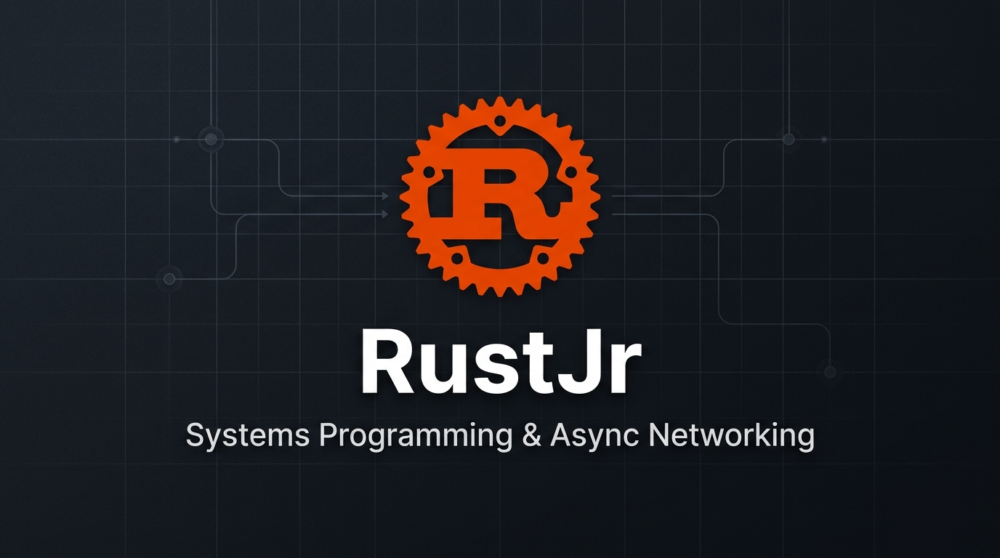

# RustJr

A hands-on collection of standalone Rust projects, experiments, and systems programming exercises.

This repository serves as my primary workspace for building low-level utilities, asynchronous network services, and systems tools while exploring the Rust language. The focus is on practical implementation: writing real, runnable code to understand memory management, concurrency models, socket I/O, and runtime mechanics from the ground up.

---

## Workspace Structure & Philosophy

Rather than keeping code snippets scattered or locked inside theoretical exercises, this repository is organized into self-contained sub-projects. Each sub-project:

- Maintains its own isolated Cargo configuration (`Cargo.toml`) and dependencies.
- Addresses a specific systems programming concept or problem (e.g., raw TCP handling, multi-client asynchronous broadcasting, filesystem manipulation).
- Can be inspected, built, and executed independently without depending on a root workspace build.

As new projects and experiments are written, they are developed directly in this workspace and published as individual projects.

---

## Prerequisites

To build and run projects in this repository, you will need a working Rust development environment:

- **Rust toolchain** (Edition 2021 / 2024 compatible, Rust 1.80+ recommended)
  ```bash
  curl --proto '=https' --tlsv1.2 -sSf https://sh.rustup.rs | sh
  ```
- **Cargo** (installed automatically with Rust)
- **Netcat (`nc`)** or **Telnet** (optional, useful for testing network listeners)
  ```bash
  # Debian / Ubuntu
  sudo apt install netcat-openbsd
  ```

---

## Running Any Project

Because each project is an independent Cargo package, the workflow is uniform across the entire workspace:

1. Navigate to the desired project folder:
   ```bash
   cd <project-folder>
   ```

2. Compile and check for errors without producing a binary:
   ```bash
   cargo check
   ```

3. Build and launch:
   ```bash
   cargo run
   ```

4. For release-optimized builds:
   ```bash
   cargo build --release
   ```

---

## Author

**Piyusha Akash**  
Portfolio: [https://0x3xp.github.io](https://0x3xp.github.io)

---

## Copyright & License

Copyright (c) 2026 Piyusha Akash. All rights reserved.  
Personal portfolio and projects: [0x3xp.github.io](https://0x3xp.github.io)
